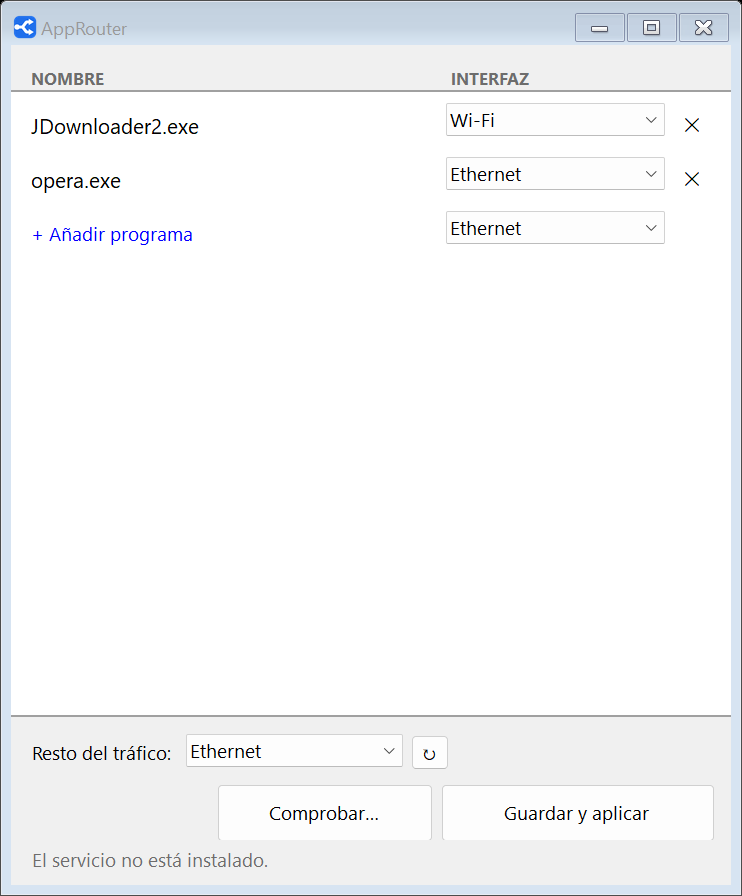
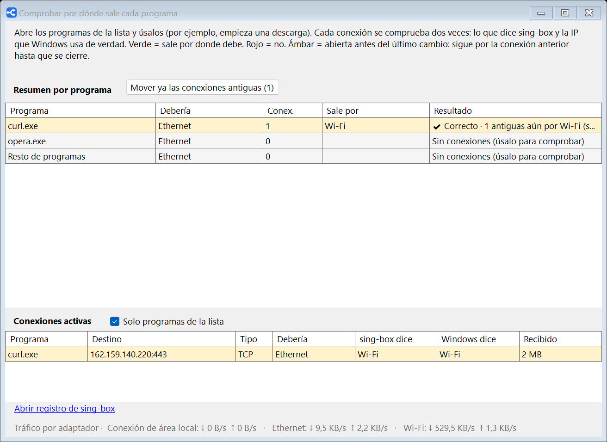

<p align="center"></p>

<h1 align="center">AppRouter</h1>

<p align="center">Elige por qué conexión de red (cable, Wi-Fi, 4G…) sale a internet <b>cada programa</b> de Windows.</p>

---

Por ejemplo: JDownloader descargando por la Wi-Fi mientras el navegador y todo lo demás siguen por el cable.

<p align="center"></p>

## Descargar e instalar

1. Descarga **`AppRouter-x.y.z.exe`** de la [última versión](../../releases/latest).
2. Ábrelo, acepta el aviso de Windows y pulsa **Instalar**.

Es un único archivo: incluye todo lo necesario (.NET y [sing-box](https://github.com/SagerNet/sing-box)), no hay que instalar nada más.
Requiere Windows 10/11 de 64 bits y permisos de administrador.

> Si aparece «Windows protegió su PC», pulsa **Más información → Ejecutar de todas formas**. Sale porque el ejecutable no está firmado digitalmente.
> Puedes comprobar el archivo con `SHA256SUMS.txt`, que se publica junto a cada versión.

## Uso

- **Añadir programa**: elige la conexión en el desplegable de esa fila y pulsa «+ Añadir programa» (o arrastra el `.exe` a la ventana).
- **Resto del tráfico**: conexión para todo lo que no está en la lista.
- **Guardar y aplicar**: se aplica al momento **sin cortar** las descargas en curso. Las conexiones ya abiertas siguen por donde iban hasta que se cierran; las nuevas usan la conexión nueva.
- **Junto al reloj**: AppRouter se abre al iniciar sesión y cerrar la ventana solo la oculta. **Salir** (clic derecho en el icono) desactiva el enrutado: todo vuelve a salir por la conexión normal de Windows.
- Las redes `10.0.0.0/8` no pasan nunca por AppRouter.

Guía para usuarios: [docs/LEEME.txt](docs/LEEME.txt).

## Comprobar que funciona

La ventana **Comprobar…** muestra en directo cada conexión de los programas de la lista y la verifica dos veces:

| Columna | De dónde sale |
|---|---|
| **sing-box dice** | La salida que eligió sing-box para esa conexión (su API local). |
| **Windows dice** | La IP local del socket real de `sing-box.exe` hacia ese destino, y a qué adaptador pertenece. No depende de sing-box. |

Verde: sale por donde debe. Rojo: no. Ámbar: conexión abierta antes del último cambio, que sigue por la conexión anterior; el botón **Mover ya las conexiones antiguas** la cierra para que el programa reconecte por la nueva. Abajo se ve además el tráfico por segundo de cada adaptador.

<p align="center"></p>

## Cómo funciona

```
programa ──► túnel (TUN de sing-box) ──► regla process_name ──► salida "direct" con bind_interface ──► Wi-Fi / Ethernet / …
```

- Un servicio de Windows (`AppRouter`) mantiene en marcha **sing-box** con un adaptador TUN (`auto_route`, `strict_route`), del que se excluye `10.0.0.0/8`.
- `config.json` solo tiene la estructura: una salida `direct` con `bind_interface` por cada adaptador y reglas que apuntan a **rule-sets locales**.
- La lista de programas (`process_name`) y la conexión por defecto (`ip_cidr 0.0.0.0/0, ::/0`) van en esos rule-sets, que sing-box **recarga en caliente** al cambiar. Por eso guardar no corta conexiones. Solo un adaptador nuevo obliga a reiniciar sing-box (la app avisa antes).
- El servicio es de inicio manual: lo arranca AppRouter al abrirse y lo detiene al salir. El inicio con Windows es una tarea programada con privilegios elevados (sin aviso de UAC).

Archivos: programa en `C:\Program Files\AppRouter\`, configuración y registro en `C:\ProgramData\AppRouter\`.

## Compilar

Requisitos: [SDK de .NET 8](https://dotnet.microsoft.com/download) o posterior en Windows.

```bash
dotnet publish AppRouter/AppRouter.csproj -c Release -o dist
```

Genera `dist/AppRouter.exe` (autocontenido, un solo archivo). La compilación **descarga sing-box** de su release oficial y **falla si su SHA-256 no coincide** con el fijado en `AppRouter.csproj`; el binario no se guarda en el repositorio.

## Publicar una versión

1. Sube `<Version>` en `AppRouter/AppRouter.csproj` y añade la entrada en [CHANGELOG.md](CHANGELOG.md).
2. Crea y sube la etiqueta:
   ```bash
   git tag v1.1.0
   git push origin v1.1.0
   ```
3. GitHub Actions ([build.yml](.github/workflows/build.yml)) compila y crea la Release con `AppRouter-1.1.0.exe`, `LEEME.txt` y `SHA256SUMS.txt`.

Para actualizar sing-box: ver [AppRouter/vendor/README.txt](AppRouter/vendor/README.txt).

## Licencia

AppRouter es software libre bajo la [GNU GPL v3](LICENSE) (o posterior).

Incluye [sing-box](https://github.com/SagerNet/sing-box) sin modificar, también bajo GPLv3; su licencia se instala junto al programa (`C:\Program Files\AppRouter\sing-box\LICENSE-sing-box.txt`).
