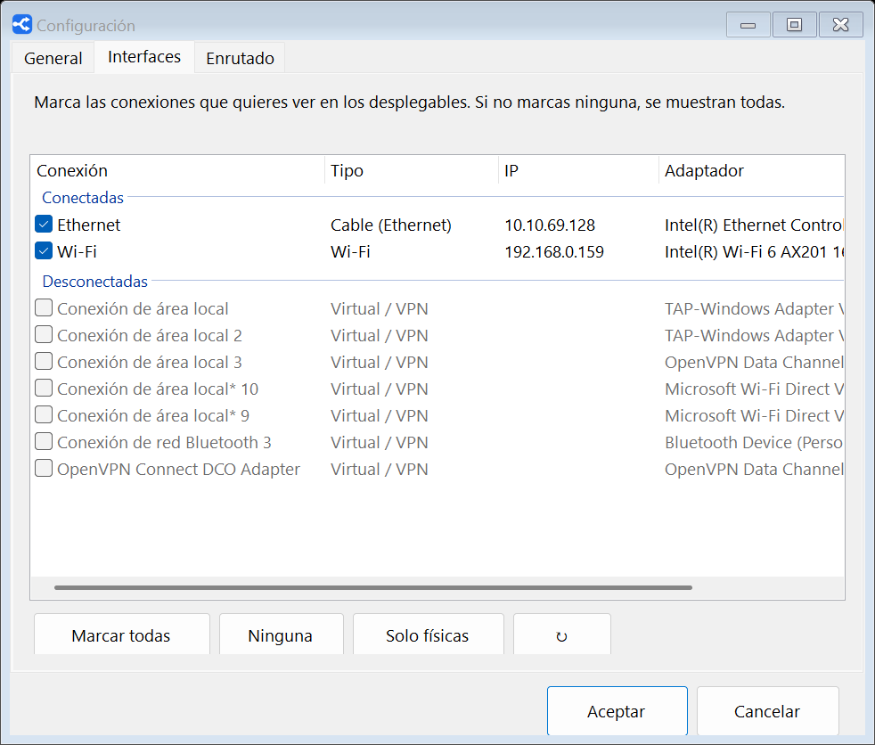

<p align="center"></p>

<h1 align="center">AppRouter</h1>

<p align="center">Elige por qué conexión de red (cable, Wi-Fi, 4G…) sale a internet <b>cada programa</b> de Windows.</p>

---

Por ejemplo: JDownloader descargando por la Wi-Fi mientras el navegador y todo lo demás siguen por el cable.

<p align="center"></p>

## Descargar e instalar

1. Descarga **`AppRouter-x.y.z.exe`** de la [última versión](https://github.com/rboluda/approuter/releases/latest).
2. Ábrelo, acepta el aviso de Windows y pulsa **Instalar**.

Es un único archivo: incluye todo lo necesario (.NET y [sing-box](https://github.com/SagerNet/sing-box)), no hay que instalar nada más.
Requiere Windows 10/11 de 64 bits y permisos de administrador.

> Si aparece «Windows protegió su PC», pulsa **Más información → Ejecutar de todas formas**. Sale porque el ejecutable no está firmado digitalmente.
> Puedes comprobar el archivo con `SHA256SUMS.txt`, que se publica junto a cada versión.
>
> La firma de código se gestionará con [SignPath Foundation](https://signpath.org) (ver [Code signing policy](#code-signing-policy)).

## Uso

- **Añadir programa**: elige la conexión en el desplegable de esa fila y pulsa «+ Añadir programa» para elegirlo de entre los programas abiertos (o con «Examinar…», o arrastrando el `.exe` a la ventana).
- **Sin internet**: en el desplegable de cada programa también puedes dejarlo sin conexión (como un cortafuegos por programa).
- **Límite de velocidad**: en la columna *Límite* de cada programa, «Ilimitado» (por defecto) o un máximo en Mbps, para la bajada y la subida de ese programa (sumando todas sus conexiones). Se aplica al momento, también a las descargas que ya están en marcha. Hasta 16 programas con límite.
- **Resto del tráfico**: conexión para todo lo que no está en la lista.
- **Guardar y aplicar**: se aplica al momento **sin cortar** las descargas en curso. Las conexiones ya abiertas siguen por donde iban hasta que se cierran; las nuevas usan la conexión nueva.
- **Junto al reloj**: AppRouter se abre al iniciar sesión y cerrar la ventana solo la oculta. **Salir** (clic derecho en el icono, o *Archivo → Salir*) desactiva el enrutado: todo vuelve a salir por la conexión normal de Windows.
- Interfaz en **español, inglés y chino**.

### Configuración (*Herramientas → Configuración…*)

| Pestaña | Opciones |
|---|---|
| **General** | Idioma · abrir al iniciar sesión · avisos cuando una conexión usada se desconecta o vuelve · buscar actualizaciones (desactivado por defecto) · exportar/importar la configuración a un archivo |
| **Interfaces** | Qué conexiones aparecen en los desplegables (por ejemplo, solo Ethernet, Wi-Fi y 4G de entre todas las del equipo) |
| **Enrutado** | Si se desconecta la conexión de un programa: dejarlo sin internet hasta que vuelva, o usar mientras tanto la del resto del tráfico (cambio automático, sin cortar lo demás) · redes que no pasan por AppRouter (por defecto `10.0.0.0/8`) |

<p align="center"></p>

Guía para usuarios: [docs/LEEME.txt](docs/LEEME.txt).

## Comprobar que funciona

La ventana **Comprobar…** muestra en directo cada conexión de los programas de la lista y la verifica dos veces:

| Columna | De dónde sale |
|---|---|
| **sing-box dice** | La salida que eligió sing-box para esa conexión (su API local). |
| **Windows dice** | La IP local del socket real de `sing-box.exe` hacia ese destino, y a qué adaptador pertenece. No depende de sing-box. |

Verde: sale por donde debe. Rojo: no. Ámbar: conexión abierta antes del último cambio, que sigue por la conexión anterior; el botón **Mover ya las conexiones antiguas** la cierra para que el programa reconecte por la nueva. Abajo se ve además el tráfico por segundo de cada adaptador, y la pestaña **Tráfico por programa** suma lo enviado y recibido por cada programa y conexión desde que se abrió AppRouter.

<p align="center"></p>

## Cómo funciona

```
programa ──► túnel (TUN de sing-box) ──► regla process_name ──► salida "direct" con bind_interface ──► Wi-Fi / Ethernet / …
```

- Un servicio de Windows (`AppRouter`) mantiene en marcha **sing-box** con un adaptador TUN (`auto_route`, `strict_route`), del que se excluyen las redes configuradas (`route_exclude_address`).
- `config.json` solo tiene la estructura: una salida `direct` con `bind_interface` por cada adaptador y reglas que apuntan a **rule-sets locales**: primero los programas sin internet (`reject`), luego los programas de la lista, luego el resto del tráfico y, si nada coincide, la ruta de Windows.
- La lista de programas (`process_name`) y la conexión por defecto (`ip_cidr 0.0.0.0/0, ::/0`) van en esos rule-sets, que sing-box **recarga en caliente** al cambiar. Por eso guardar no corta conexiones. Solo un adaptador nuevo o cambiar las redes excluidas obliga a reiniciar sing-box (la app avisa antes).
- **Límite de velocidad**: sing-box no tiene ninguno, así que los programas con límite se envían a un pequeño proxy SOCKS5 que va dentro del servicio de AppRouter (solo escucha en `127.0.0.1` y pide contraseña). Reparte la velocidad con un cubo de tokens por programa y sentido (TCP y UDP) y sale por la interfaz elegida igual que sing-box (`IP_UNICAST_IF`). Cada programa limitado ocupa uno de 16 huecos fijos (salidas `lim-1`…`lim-16`), así que añadir o cambiar límites solo toca rule-sets y `limits.json`, que se releen en caliente. El DNS (puerto 53) de esos programas va directo, sin pasar por el limitador.
- AppRouter vigila los cambios de red: si cae la conexión de un programa y se eligió «usar la del resto», reescribe los rule-sets para que ese programa salga por la otra mientras tanto, y lo devuelve cuando vuelve.
- El servicio es de inicio manual: lo arranca AppRouter al abrirse y lo detiene al salir. El inicio con Windows es una tarea programada con privilegios elevados (sin aviso de UAC).

Archivos: programa en `C:\Program Files\AppRouter\`, configuración y registro en `C:\ProgramData\AppRouter\`.

## Compilar

Requisitos: [SDK de .NET 8](https://dotnet.microsoft.com/download) o posterior en Windows.

```bash
dotnet publish AppRouter/AppRouter.csproj -c Release -o dist
```

Genera `dist/AppRouter.exe` (autocontenido, un solo archivo). La compilación **descarga sing-box** de su release oficial y **falla si su SHA-256 no coincide** con el fijado en `AppRouter.csproj`; el binario no se guarda en el repositorio.

## Publicar una versión

1. Sube `<Version>` en `AppRouter/AppRouter.csproj` y añade la entrada en [CHANGELOG.md](CHANGELOG.md).
2. Crea y sube la etiqueta:
   ```bash
   git tag -a v1.3.0 -m "AppRouter 1.3.0"
   git push origin v1.3.0
   ```
3. GitHub Actions ([build.yml](.github/workflows/build.yml)) compila y crea la Release con `AppRouter-1.3.0.exe`, `LEEME.txt` y `SHA256SUMS.txt`.

Traducciones y cómo colaborar: [CONTRIBUTING.md](CONTRIBUTING.md).

Para actualizar sing-box: ver [AppRouter/vendor/README.txt](AppRouter/vendor/README.txt).

## Code signing policy

Free code signing provided by [SignPath.io](https://about.signpath.io), certificate by [SignPath Foundation](https://signpath.org).

- **Committers and reviewers:** [rboluda](https://github.com/rboluda)
- **Approvers:** [rboluda](https://github.com/rboluda)

Only `AppRouter.exe` built from this repository by [GitHub Actions](.github/workflows/build.yml) is signed, and every signing request is approved manually. The bundled [sing-box](https://github.com/SagerNet/sing-box) binaries are included unmodified from their official upstream release.

## Privacy

This program will not transfer any information to other networked systems unless specifically requested by the user or the person installing or operating it.

AppRouter only changes how the user's own network traffic leaves the computer, according to the rules the user configures. Its settings and logs stay on the local machine (`C:\ProgramData\AppRouter\`), and it talks to sing-box only through local endpoints bound to `127.0.0.1` (sing-box's API and AppRouter's own speed limiter). It contains no telemetry or analytics.

The only connection AppRouter itself makes is the update check, and only when the user asks for it: either with *Help → Check for updates*, or by turning on *Check for updates automatically* in Settings (off by default). It then requests the latest release from the public GitHub API (`api.github.com/repos/rboluda/approuter/releases/latest`), at most once a day. The request carries nothing about the user beyond what any HTTPS request does (IP address and a `User-Agent` with the AppRouter version).

## Licencia

AppRouter es software libre bajo la [GNU GPL v3](LICENSE) (o posterior).

Incluye [sing-box](https://github.com/SagerNet/sing-box) sin modificar, también bajo GPLv3; su licencia se instala junto al programa (`C:\Program Files\AppRouter\sing-box\LICENSE-sing-box.txt`).
